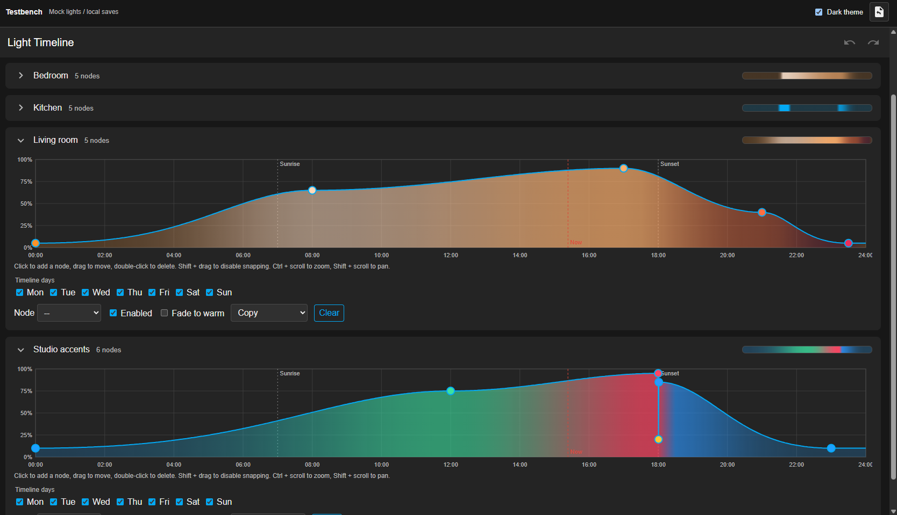
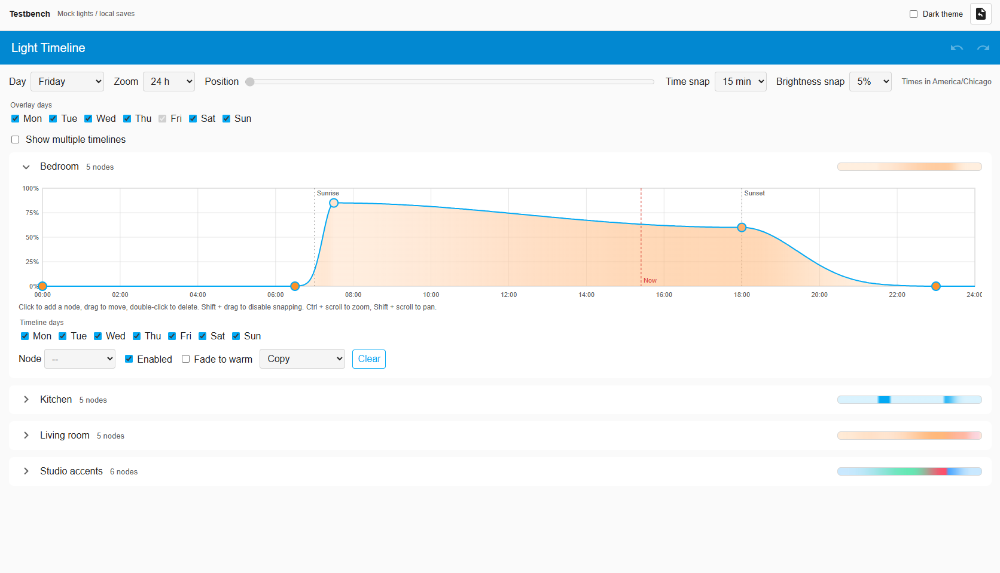
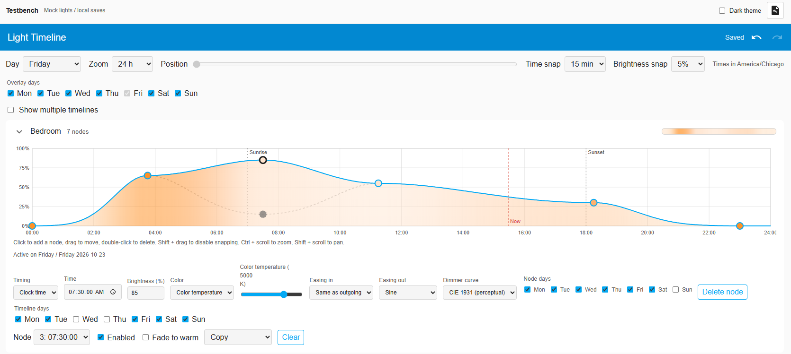

# Home Assistant Light Timeline

Light Timeline is a custom Home Assistant integration for scheduling brightness and color changes across a day with an interactive timeline editor. The integration targets Home Assistant Core **2026.9.4**. The browser testbench uses mock lights and does not connect to Home Assistant or control real devices.

## Features


## Screenshots

### Dark mode



### Light mode



### Weekday overlays



## Requirements

### Home Assistant integration

- Home Assistant Core 2026.9.4 or later.
- Home Assistant location coordinates configured if you want to use sunrise or sunset anchors.
- No additional integration packages or frontend build tools. The integration declares no external Python requirements.

### Browser testbench

- Python 3, for Python's built-in static HTTP server.
- A modern browser with JavaScript and local storage enabled.
- Node.js and npm are optional; they are only needed to run the `npm run demo` convenience script. No npm install or frontend build is needed.

### Backend tests

- Python 3.
- Home Assistant Core and its Python dependencies installed in the active Python environment. Run the tests from a Home Assistant Core development environment, or an environment where the `homeassistant` package is available.

## Getting Started: Browser Demo

From the repository root, start the demo server with Python:

```sh
python3 -m http.server 8124 --bind 127.0.0.1
```

Then open <http://127.0.0.1:8124/demo/>. The demo starts in dark mode and provides four mock lights, sample daily timelines, a theme toggle, and a restore-samples button. Changes are saved in that browser's local storage. They do not affect real lights.

Alternatively, if Node.js and npm are installed:

```sh
npm run demo
```

In VS Code, run **Tasks: Run Task** and select **Timeline: Demo server**. It serves the same URL using Python; Node.js is not required for this task.

Stop the server with Ctrl+C in its terminal. If port 8124 is already occupied, run Python on another port, for example `python3 -m http.server 8125 --bind 127.0.0.1`, and open `http://127.0.0.1:8125/demo/`.

## Install in Home Assistant

1. Copy `custom_components/light_timeline` into the `custom_components` directory in your Home Assistant configuration directory. Create `custom_components` if it does not exist.
2. Restart Home Assistant.
3. In Home Assistant, open **Settings → Devices & services → Add integration**, then search for **Light Timeline**.
4. Open the integration's options to select lights. Leave the light selection empty to show all lights. You can also set the scheduler update interval and choose whether to only adjust lights that are already on.
5. Open **Light Timeline** from the sidebar. Configure schedules in the editor; timeline changes are saved automatically.

The **Schedule** switch can be used to pause or resume the scheduler from Home Assistant or an automation. Sunrise and sunset calculations use Home Assistant's configured location and time zone. Lights that support neither color temperature nor RGB receive brightness changes only.

## Run Backend Tests

From the repository root, in a Python environment with Home Assistant Core installed:

```sh
python3 -m unittest discover -s tests -v
```

The tests cover interpolation and easing, weekday and solar scheduling, manual overrides, and light capability handling.
